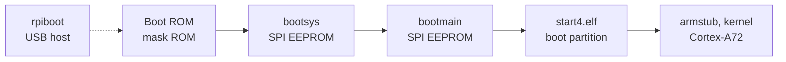

# Architecture

open27xx documents the closed VideoCore boot firmware of Broadcom BCM27xx SoCs and develops open replacements for it. The BCM2711 is the first target; this document describes its boot chain, the replacement plan and the layout of the repository. Details of each stage are in [bcm2711/](bcm2711/).

## Boot chain

On the BCM2711 the boot ROM and three firmware stages run on the VideoCore VPU before the first ARM instruction executes.

| Stage | Stored in | Checked by | Function |
|---|---|---|---|
| Boot ROM | mask ROM | — | Loads bootsys from the SPI EEPROM, `recovery.bin` from an SD card (Raspberry Pi 4 Model B), or a loader over USB. |
| bootsys | EEPROM section 0 | boot ROM: signature footer | Initializes SDRAM. Loads bootmain and its resources and checks them against SHA-256 digests embedded in bootsys. |
| bootmain | EEPROM, compressed section | bootsys: SHA-256 | Reads the boot configuration and runs the boot modes. Loads `start4.elf` and `fixup4.dat`, or `boot.img` when secure boot is enabled. |
| `start4.elf` | boot partition | nothing, unless secure boot is enabled | VideoCore firmware: reads `config.txt`, loads the device tree and the kernel, starts the ARM cores and serves the mailbox interface. |
| armstub, kernel | armstub: built into `start4.elf`, or a file named by `armstub=`; kernel: boot partition | — | Open source. |

Two properties of the chain set the order of work:

- Without secure boot, bootmain loads `start4.elf` from the boot partition without any check. An open `start4.elf` therefore runs on unmodified hardware.
- The boot ROM accepts bootsys only with a valid signature footer, and bootsys accepts bootmain only if its digest matches. Replacements for these two stages are developed and verified in emulation.

## Replacement plan

| Component | Deliverable | Verification |
|---|---|---|
| EEPROM image | `tools/eeprom.py`: list, extract, verify, rebuild | byte-identical round trip of every published image |
| `start4.elf` | VPU firmware built with GCC from vc4-toolchain | Linux boots on a Compute Module 4; mailbox replies match the vendor firmware |
| bootmain | portable C library: configuration parser, boot-mode selection, file loading | same results as the vendor code in emulation |
| bootsys, SDRAM | documentation of the SDRAM initialization sequence | — |

## Verification

Each component is compared with the vendor firmware at the lowest level that applies:

- data formats: byte for byte, on every published image;
- functions: the vendor code runs in the Ghidra p-code emulator with the VideoCore IV processor module, with the same inputs as the open code;
- boot behavior: UART log, mailbox replies and boot result on a Compute Module 4.

Byte-identical binaries are not a goal. The vendor firmware is built with the MetaWare toolchain, so equivalence is defined by behavior.

The processor module decodes the VPU vector instructions but does not model their semantics, so vendor functions that use them cannot be compared in the emulator.

## Clean-room process

All work follows the clean-room process in [CONTRIBUTING.md](../CONTRIBUTING.md).

## Code map

| Path | Contents |
|---|---|
| `docs/` | this document, per-SoC documentation and references |
| `tools/` | host tools |
| `tests/` | unit tests on synthetic data, and integration tests on the pinned vendor files |
| `scripts/` | fetch and verify the pinned vendor files |

Firmware sources go to `src/`, one directory per stage, when the first stage is added.

## Invariants

- The repository contains no vendor firmware and no code derived from it.
- Every statement about vendor firmware names the file and its version; `scripts/blobs.sha256` identifies the exact bytes.
- Integration tests skip when the vendor files are absent; all other tests run without them.
